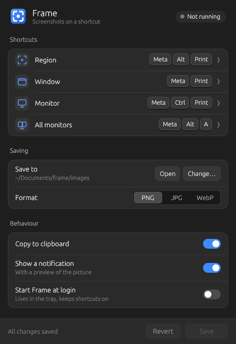

# Frame

Screenshots for Linux, driven by global shortcuts. `frame` is one Rust
binary: the command line, the tray icon and the settings window. One
config file.
Works on KDE Plasma, GNOME, Hyprland, Sway and X11.

- Region, active window, current monitor or all monitors, each on its
  own shortcut.
- Saves to `~/Documents/frame/images` as PNG, JPG or WebP and copies
  the picture to the clipboard.
- A notification previews each shot, with **Open** and **Show in
  folder** buttons.
- Nothing else to install: capture, area selection, encoding and the
  clipboard are built in (no grim, slurp, ffmpeg, wl-copy or xclip).



## Download

Get `Frame-x86_64.AppImage` from the
[latest release](https://github.com/uhd3mon/frame/releases/latest),
then:

```sh
chmod +x Frame-x86_64.AppImage
./Frame-x86_64.AppImage
```

The settings window opens. Press **Install Frame** so shortcuts and
start at login keep working (see Quick start). The AppImage runs on
x86_64 distributions from about 2022 on (Ubuntu 22.04, Debian 12,
Fedora 36 or newer).

Frame used to be called Clipped. The first time it runs it copies
`~/.config/clipped/config` to `~/.config/frame/config` (if there is no
Frame config yet) and says so; the old file stays where it was. Nothing
else is moved: your old captures stay in `<save_dir>/clipped/`, new
screenshots go to `<save_dir>/frame/images`. `frame install` removes an
old Clipped install from the same `PREFIX` (below).

## Quick start

From source:

```sh
./install.sh    # builds frame (needs cargo), installs to ~/.local
frame           # start Frame now; from then on it starts when you log in
```

From the AppImage: run `Frame-x86_64.AppImage` and press **Install
Frame** in the settings window, or run `Frame-x86_64.AppImage install`.
Both copy the binary inside the AppImage to `~/.local/bin/frame` (KDE
Plasma 6.7 and older only let an installed frame take screenshots).

The tray binds the shortcuts below when it starts (`frame bind`). On
KDE and GNOME they stay bound after Quit and across logins; Hyprland and
Sway forget them when the session ends, so there keep the tray starting
at login, or run `frame bind` from your compositor's autostart.

Since 0.4 Frame is pictures only: replay, recording and `frame.service` are
gone. Old video keys in your config are ignored without a warning, and
`frame bind` / `frame unbind` remove the replay / record shortcuts an
older Frame bound.

## Install

```sh
./install.sh                 # build + install to ~/.local
./install.sh --no-autostart  # same, but don't start Frame at login
./install.sh --uninstall
frame install [--force] [--no-autostart]   # what install.sh runs
frame uninstall
```

`install.sh` only builds (`cargo build --release`; `--no-build` skips
that) and runs `target/release/frame install` (or `frame uninstall`).
The installing is done by frame itself, so the AppImage can install
itself too. It copies the running binary to `$PREFIX/bin` (default `~/.local`), the
`frame` icon to `share/icons/hicolor` and a **Frame** start-menu entry
(`share/applications/frame.desktop`, runs `frame`). A first install (not
`DESTDIR`, not a reinstall) also turns on **Start Frame when I log in**
(`~/.config/autostart/frame.desktop`, runs `frame tray`); a reinstall
keeps whatever you chose in Settings. `PREFIX=/usr/local` and
`DESTDIR=/tmp/pkg` work as usual (environment variables). The list of installed files goes to
`share/frame/installed`. Install refuses to replace a `bin/frame` it
didn't put there (`--force` does). `--uninstall` removes only the listed
files; for a real install (no `DESTDIR`) it first stops the tray (waits
up to 12 s), removes the shortcuts (`frame unbind`), and removes the start-at-login entry if
it starts this frame. Install and uninstall stop only the tray and
settings window; captures, the clipboard holder (`frame _clip`) and
notifications keep running. A running tray (also the AppImage's) is
restarted from the installed binary, and a start-at-login entry that ran
the AppImage now runs the installed frame.

Upgrading from Frame 0.4 (Bash `frame` + `frame-gui`): a real install
stops the old tray, replaces `bin/frame`, removes `bin/frame-gui` and
turns `~/.config/autostart/frame-gui.desktop` into
`~/.config/autostart/frame.desktop` (unless you had turned it off).

Upgrading from Frame 0.3 (video): a real install or uninstall turns off
and removes `~/.config/systemd/user/frame.service` and removes the
`frame-replay` / `frame-record` shortcut entries in
`~/.local/share/applications`. Your videos stay where they are.

Upgrading from Clipped: a real install (no `DESTDIR`) that finds
`share/clipped/installed` in the same `PREFIX` first stops `clipped-gui`,
runs the old `clipped service off` and `clipped unbind`, removes the
files that list names (and the list) and
`~/.config/autostart/clipped-gui.desktop` if it starts that clipped-gui.
`~/.config/clipped` and your captures are not touched.

## Tray and settings

The tray runs `frame bind` once when it starts, then waits for you.
Menu: Region, Window, Monitor, All monitors, Open folder, Settings…,
Quit. Clicking the icon opens the settings. Its pid is in
`$XDG_RUNTIME_DIR/frame/tray.pid` (`frame status` shows it).

The settings window edits the config file: save folder, image format,
clipboard and notification switches, the four shortcuts (type them, or
press **Record** and then the keys) and **Start Frame at login**. Save
keeps your comments and line order and only changes the values you
edited. It checks the new file first (same rules as `frame check`); if
it is rejected, the real file is left alone and the error is shown. Changed
shortcuts are re-applied right away (and on the first Save if Frame has
never bound them).

| Command | What it does |
|---|---|
| `frame` | tray if not running, and the settings window |
| `frame tray` | tray (only one runs; a second start opens settings) |
| `frame settings` | only the settings window (one at a time) |

The tray needs a StatusNotifierItem host (KDE, most panels; GNOME needs
the AppIndicator extension).

## Commands

| Command | What it does |
|---|---|
| `frame region` | pick an area |
| `frame window` | the active window |
| `frame monitor` | the current monitor |
| `frame all` | all monitors |
| `frame bind` / `frame unbind` | add / remove the shortcuts |
| `frame status` | config, save folder, bound shortcuts, tray |
| `frame config` | create the config if missing, print path |
| `frame check [FILE]` | validate the config (or FILE): `ok`, or the error and exit 2 |
| `frame --detect` | show the backends frame would use |

Each screenshot is saved, copied to the clipboard as image data and
announced with a notification that previews it and has **Open** and
**Show in folder** buttons. On KDE the preview can be dragged out like
Spectacle's. Errors from a shortcut (no display, KWin refused…)
show a critical notification.

## Config

One file: `~/.config/frame/config` (or `$XDG_CONFIG_HOME/frame/config`;
`FRAME_CONFIG` overrides it). Plain `key = value` lines. `#` starts a
comment at the start of a line or after a space (`a#b` is a value).
Values may be wrapped in one pair of quotes. Only `~` and `~/` are
expanded, `$VARS` are not; `save_dir` must end up absolute. The file is
parsed, never executed; bad values stop frame with exit code 2.

| Key | Default | Notes |
|---|---|---|
| `save_dir` | `~/Documents` | screenshots go to `frame/images` |
| `image_format` | `png` | `png`, `jpg` (quality 90), `webp` (lossless) |
| `clipboard` | `true` | |
| `notify` | `true` | toast with preview |
| `bind.region` | `Meta+Alt+R` | |
| `bind.window` | `Meta+Alt+W` | |
| `bind.monitor` | `Meta+Alt+M` | |
| `bind.all` | `Meta+Alt+A` | |

Shortcuts use KDE-style names: modifiers `Meta`, `Ctrl`, `Alt`, `Shift`
plus exactly one key (a letter, digit, `F1`–`F35`, `Print`, `Space`,
`Home`, `PgUp`…). Anything else is rejected. An empty value means no
shortcut. Keys Frame no longer uses (the video settings of Frame 0.3:
`video_*`, `replay*`, `audio`, `bind.replay`, `bind.record`) are
ignored; any other unknown key gets a warning.
Files are named `YYYY-MM-DD_HH-MM-SS_<action>.<ext>`.

## Backends

| Desktop | Screenshots | Shortcuts |
|---|---|---|
| KDE Plasma (Wayland) | KWin's ScreenShot2 over D-Bus | KGlobalAccel over D-Bus (via .desktop files) |
| Hyprland, Sway, other wlroots | ext-image-copy-capture or wlr-screencopy; focused window/monitor over the compositor's IPC socket | `hyprctl keyword bind` / `swaymsg bindsym` |
| GNOME (Wayland) | the desktop portal's Screenshot | gsettings custom keybindings |
| Any X11 desktop (KDE, GNOME, others) | GetImage on the root window, RandR monitors | KGlobalAccel / gsettings / printed for you to add |

Everything is built into the `frame` binary: there is nothing else to
install. Capture, the area selector, PNG/JPG/WebP encoding, the clipboard
and notifications are all our own code. The shortcut backends drive the
tools each desktop ships with itself (hyprctl, swaymsg, gsettings).

**Region** works the same everywhere: frame captures the screen first,
then shows that frozen picture dimmed on every monitor. Drag a rectangle
(white border), release to take it. A click without dragging takes the
whole monitor under the pointer, Esc or right-click cancels. What you see
is what you get. On KDE, Sway and Hyprland the selector is a layer-shell
overlay. GNOME has no layer-shell, so there it uses fullscreen windows.

On KDE Wayland no Spectacle is needed: frame asks KWin's built-in
ScreenShot2 D-Bus API for the pixels (`frame --grab
all|monitor|window|area X Y W H OUT.png` does only that, for debugging).
KWin 6.7 and older only answer a program named by a `.desktop` file with
`X-KDE-DBUS-Restricted-Interfaces`, so there this works once `frame
install` has written `frame.desktop` (its `Exec=` is the absolute path of
the installed frame; the shortcut entries `frame-<action>.desktop` carry
the key too). KWin 6.8 no longer checks.

GNOME: Mutter lets no other program copy the screen, so frame asks the
desktop portal. The first time, GNOME may ask once whether Frame may take
screenshots. You can change that later in Settings → Apps.
`frame monitor` takes the primary monitor (GNOME doesn't tell other
programs which monitor is in use). `frame window` opens GNOME's own
screenshot picker. A Wayland desktop that has neither screencopy
protocol (and isn't KDE) gets the portal too.

Clipboard: on Wayland a small `frame _clip` process serves the picture
until something else is copied. It uses wlr data-control where the
desktop has it (KDE, Sway, Hyprland, other wlroots). GNOME has no
data-control, so there frame maps a 1×1 transparent window for a moment
to get keyboard focus, sets the clipboard with it and closes it again.
On X11 frame owns the CLIPBOARD selection itself (large pictures go in
INCR chunks). Notifications go straight to the desktop's notification
service over D-Bus. Their Open and Show in folder buttons use the file
manager's D-Bus API or the desktop portal (xdg-open only as a last resort
if neither answers).

frame never takes a shortcut that is already in use: KDE reports taken
combos (frame warns and skips them), on Hyprland it checks
`hyprctl binds -j`, on Sway it reads your config (`swaymsg -t
get_config`; best effort: `set $var` is expanded, mode blocks count as
taken). What frame bound is recorded in `~/.local/state/frame/binds`, and
`frame unbind` removes exactly that, not whatever the config says now.
If GNOME's shortcut list can't be read, frame changes nothing.

Hyprland and Sway shortcuts only last for the running session; the
tray applies them when it starts (see Quick start).

## Test

```sh
cargo test           # CLI, config, capture, binds, toasts, settings
bash tests/smoke.sh  # install.sh wrapper checks
```

`cargo test` runs frame's commands with `FRAME_DRY_RUN=1`, temp XDG dirs
and a `PATH` holding only fake tools: no screenshots, clipboard,
notifications or shortcut changes; install tests use temp `PREFIX`,
`HOME` and XDG dirs. `tests/smoke.sh` checks that `install.sh` passes its
options on, then installs and uninstalls the real built frame in an
isolated temp `HOME` (no D-Bus, no display).

## Licence

MIT. See [LICENSE](LICENSE).
